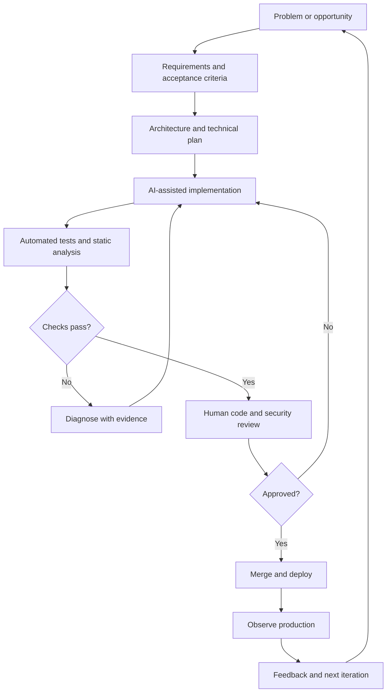
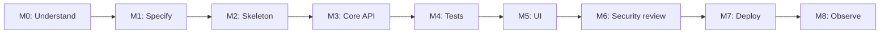
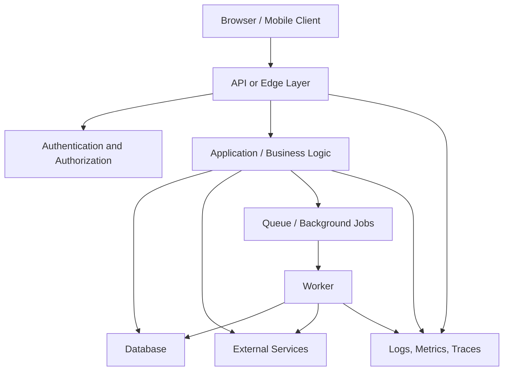
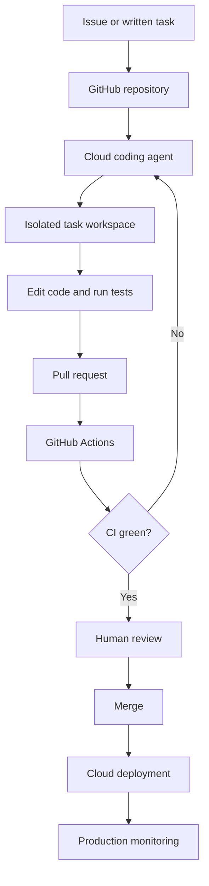
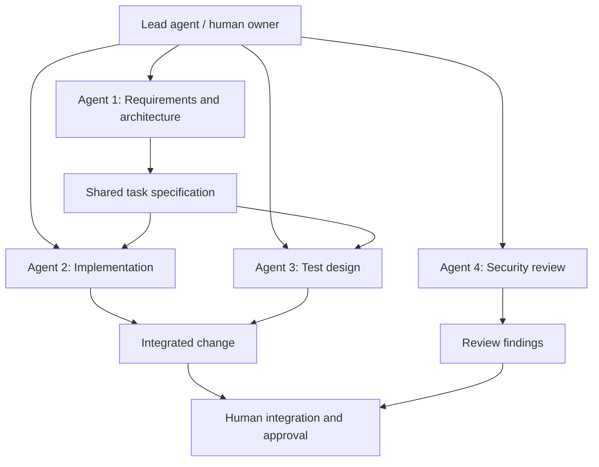
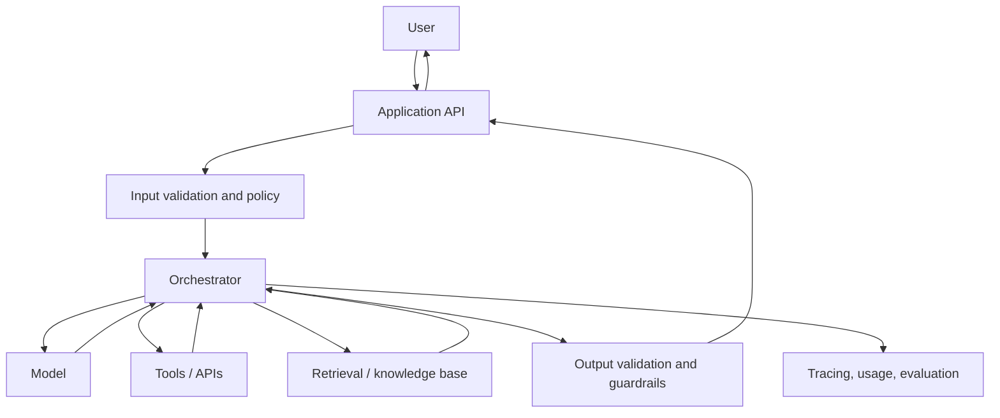

# Building Software with AI

## From idea to production: a practical guide to the new software engineering workflow

Software development is undergoing a fundamental change. For decades,
building an application required a person to translate an idea into
requirements, design an architecture, write code, test it, deploy it,
and maintain it. Tools improved at every stage, but the developer
remained responsible for translating intent into thousands of lines of
implementation.

AI changes that relationship.

A developer can now describe a feature in natural language, ask an AI
system to inspect an unfamiliar repository, request an implementation
plan, delegate changes across several files, run tests, investigate
failures, and prepare a pull request. Some tools can work in a local
terminal or IDE; others can operate against a GitHub repository in an
isolated cloud environment. The developer increasingly directs and
verifies work rather than manually producing every line.

This is not the end of software engineering. It is a change in where
engineering effort is spent. The value shifts from typing code to
defining the right problem, supplying accurate context, making sound
architectural decisions, evaluating results, and controlling risk.

The most useful mental model is simple:

> AI can accelerate implementation. The human remains accountable for
> the system.

This article explains how to build real software with AI---from a small
utility to a production service---without confusing impressive
demonstrations with dependable engineering.

------------------------------------------------------------------------

## 1. What does "building software with AI" actually mean?

The phrase covers several different levels of capability. Understanding
the distinction helps choose the right workflow.

### Level 1: AI as a coding assistant

You ask a chatbot to explain a function, generate a regular expression,
write a SQL query, or suggest a fix. You copy the result into your
editor and decide what to do next.

The AI is useful, but it has limited awareness of the surrounding
application. It may not know the repository conventions, dependency
versions, existing abstractions, or tests unless you provide them.

### Level 2: AI as an IDE assistant

Tools such as GitHub Copilot and Cursor can work closer to the code.
They can use open files and repository context to suggest edits,
complete code, explain errors, and help navigate a project.

The developer still controls most of the sequence: inspect, edit, run,
debug, and repeat.

### Level 3: AI as an agentic coding system

An agent can pursue a goal through multiple steps. Depending on the
product and permissions, it can:

1.  Inspect the repository and identify relevant files.
2.  Search for existing implementations and conventions.
3.  Propose a plan.
4.  Edit multiple files.
5.  Run shell commands, builds, linters, and tests.
6.  Interpret failures and attempt corrections.
7.  Review a diff and prepare a commit or pull request.

Examples include OpenAI Codex, Claude Code, Cursor Agent, and GitHub
Copilot's agentic workflows. Their capabilities and execution
environments differ, so check the documentation for the particular
product and plan you use.

### Level 4: AI embedded in the software delivery process

At this level, agents are part of a broader engineering system. They may
help triage issues, generate tests, review pull requests, update
documentation, investigate production errors, or execute a controlled
release workflow.

This is where the greatest productivity gains can emerge---but also
where permissions, auditability, test quality, and human approval become
especially important.

### A useful comparison

  -----------------------------------------------------------------------
  Approach          What the AI sees  Typical work      Human
                                                        responsibility
  ----------------- ----------------- ----------------- -----------------
  Chat assistant    The prompt and    Explanations,     Integrate and
                    supplied snippets small code blocks test

  IDE assistant     Open files and    Completion,       Direct the
                    selected          edits, debugging  workflow
                    repository                          
                    context                             

  Coding agent      Repository plus   Multi-file        Scope, supervise,
                    permitted tools   features, tests,  review
                                      refactors         

  Delivery agent    Repository and    PRs, triage,      Approvals,
                    connected         release support   policy,
                    delivery systems                    production
                                                        accountability
  -----------------------------------------------------------------------

The important distinction is not whether a product calls itself an
agent. It is what context it can inspect, which tools it can invoke,
what permissions it has, and how its work is verified.

------------------------------------------------------------------------

## 2. The new software development lifecycle

Traditional software development is often represented as a sequence of
human-led phases. AI does not eliminate these phases; it changes how
work moves through them.



The loop matters. An agent can produce code quickly, but speed is useful
only when the result is correct, maintainable, secure, and aligned with
the product.

A robust AI workflow therefore has five recurring activities:

-   **Specify:** define the problem, constraints, and observable success
    criteria.
-   **Contextualise:** give the agent the repository structure,
    conventions, relevant documentation, and boundaries.
-   **Delegate:** assign a bounded task with a clear expected outcome.
-   **Verify:** run tests, inspect diffs, check security, and validate
    behaviour.
-   **Learn:** update project documentation and tests so future work
    starts with better context.

------------------------------------------------------------------------

## 3. Start with the problem, not the prompt

One of the most common mistakes in AI-assisted development is beginning
with a vague instruction:

> Build me a complete customer management application.

That sentence leaves hundreds of decisions unanswered: who uses the
system, what data is stored, how users authenticate, what permissions
exist, which workflows matter, how data is retained, and what "complete"
means.

A coding agent may fill those gaps with plausible assumptions. Plausible
is not the same as correct.

### Convert an idea into a small specification

Before asking an agent to write code, create a short product brief.

A useful specification includes:

1.  **Problem:** What pain or opportunity are we addressing?
2.  **Users:** Who will use the software?
3.  **Primary workflow:** What should a user be able to accomplish?
4.  **Scope:** What is included in this release?
5.  **Non-goals:** What must not be built yet?
6.  **Data:** What information is stored, and who can access it?
7.  **Constraints:** Budget, hosting, language, platform, latency,
    privacy, and dependencies.
8.  **Acceptance criteria:** How will we prove the feature works?

For example, a first release of a call-screening assistant might be
specified as:

-   Accept a call event from a trusted telephony integration.
-   Collect caller metadata and a transcript when available.
-   Classify the call as likely legitimate, spam, or uncertain.
-   Present the classification and evidence to the user.
-   Never claim certainty when evidence is incomplete.
-   Log decisions without storing unnecessary sensitive information.
-   Provide a manual override.

This is much more actionable than "build an AI call assistant."

### Write acceptance criteria that can be tested

Weak criterion:

-   The application should be secure.

Better criteria:

-   Unauthenticated requests to protected endpoints return HTTP 401.
-   A user cannot read another user's records by changing an identifier.
-   API secrets are loaded from environment variables and never
    committed.
-   Invalid input is rejected with a documented error response.
-   Rate limits are enforced server-side, not only in the user
    interface.

Acceptance criteria turn subjective requests into verifiable outcomes.

------------------------------------------------------------------------

## 4. Choose the right AI development tools

There is no single tool that is best for every project. The choice
depends on where the code lives, how much autonomy is needed, the
developer's preferred environment, and the level of control required.

### Major categories and examples

  -----------------------------------------------------------------------
  Tool                    Category                Where it fits
  ----------------------- ----------------------- -----------------------
  ChatGPT                 General AI assistant    Requirements,
                                                  architecture,
                                                  explanations,
                                                  debugging, reviews

  OpenAI Codex            Coding agent            Repository tasks,
                                                  implementation,
                                                  testing, code review

  Claude Code             Agentic coding tool     Terminal- and
                                                  repository-oriented
                                                  development

  Cursor                  AI-first code editor    Codebase-aware editing
                                                  and multi-file agent
                                                  tasks

  GitHub Copilot          Coding assistant and    IDE assistance and
                          agent workflows         GitHub-centric
                                                  development

  Gemini CLI              Terminal-based AI agent Repository tasks and
                                                  command-line workflows

  GitHub Actions          CI/CD automation        Repeatable builds,
                                                  tests, checks, and
                                                  deployments

  Playwright              Browser automation and  End-to-end verification
                          testing                 of web applications

  Sentry                  Error monitoring        Production exception
                                                  visibility and
                                                  diagnosis
  -----------------------------------------------------------------------

These tools are not interchangeable. GitHub Actions is not a coding
model; it is an automation platform. Playwright is not an AI agent; it
is a browser automation and testing framework. A reliable workflow
combines tools with distinct responsibilities.

### A practical selection framework

Choose a tool by asking:

-   Can it access the repository I want it to work on?
-   Can it inspect more than the currently open file?
-   Can it run tests and commands, or only suggest code?
-   Does it show a reviewable diff?
-   Can I restrict file, network, and deployment permissions?
-   Does it support the workflow I actually use: local IDE, browser,
    GitHub, or cloud?
-   What are the usage limits, pricing model, and data-handling terms?

A cloud coding agent can be especially useful when a developer does not
want to maintain a local development environment. A local terminal agent
may be preferable when the project depends on local hardware, private
services, or tools that are not available in a cloud workspace.

------------------------------------------------------------------------

## 5. Give the agent repository context

A coding agent is only as effective as its understanding of the project.
A repository is more than source code. It includes architectural
decisions, naming conventions, scripts, tests, deployment configuration,
dependency constraints, and historical decisions.

Start by asking the agent to inspect before editing.

### A good repository discovery prompt

``` text
Do not modify any files yet.

Inspect this repository and report:

1. The application purpose and major components.
2. The languages, frameworks, and important dependencies.
3. The entry points and main request/data flows.
4. How configuration and secrets are handled.
5. How tests, linting, and builds are run.
6. How deployment works.
7. Existing architectural conventions that new code should follow.
8. Risks, missing documentation, and areas you do not understand.

Cite file paths and relevant symbols for important findings.
Do not guess when evidence is missing.
```

This first pass creates a shared understanding and reveals whether the
agent has actually inspected the project.

### Add durable project instructions

Keep project-specific instructions in version control. Common examples
include:

-   `AGENTS.md` for agent guidance in compatible coding environments.
-   `CLAUDE.md` for Claude Code project instructions.
-   `.github/copilot-instructions.md` for GitHub Copilot repository
    guidance.
-   `README.md` for human-facing setup and project orientation.
-   `docs/architecture.md` for architecture and key design decisions.

Do not assume every tool reads every instruction file. Check its
documentation and, where possible, ask the agent to confirm which
instructions it loaded.

Example `AGENTS.md`:

``` markdown
# Project instructions

## Engineering principles
- Prefer small, focused changes.
- Follow existing patterns before introducing new abstractions.
- Do not add dependencies without explaining why.
- Keep public APIs backward compatible unless the task says otherwise.

## Quality
- Add or update tests for behaviour changes.
- Run the relevant test suite before reporting completion.
- Run linting and type checks when available.
- Never claim a command passed unless it was actually executed.

## Security
- Never commit secrets, tokens, private keys, or production data.
- Validate all untrusted input at system boundaries.
- Enforce authorization on the server.
- Treat logs as potentially sensitive.

## Workflow
- Inspect before editing.
- Present a plan for multi-file or architectural changes.
- Summarise changed files, tests, limitations, and deployment implications.
```

The purpose is not to create a giant prompt. It is to preserve the rules
that should apply to every task.

------------------------------------------------------------------------

## 6. Break work into small, verifiable tasks

AI agents can make broad changes, but broad tasks are difficult to
review. If the instruction covers the database, API, UI, authentication,
billing, and deployment simultaneously, a failure can be hard to
isolate.

Use incremental milestones.



A milestone should produce a tangible result: a design note, a working
endpoint, a test suite, a deployment, or a review report.

### Example: build a small API endpoint

Instead of:

``` text
Build the entire billing system.
```

Use a sequence:

``` text
Task 1 — Discovery
Inspect the current API and identify where billing routes, configuration,
and persistence belong. Do not edit files.

Task 2 — Design
Propose the request/response contract, data model, failure cases,
idempotency strategy, and security requirements. Do not implement yet.

Task 3 — Implementation
Implement only the payment-intent creation endpoint using the approved
design. Follow existing project patterns.

Task 4 — Tests
Add tests for valid requests, invalid input, unauthorized access,
provider failures, duplicate requests, and unexpected exceptions.

Task 5 — Review
Inspect the diff for security, data integrity, error handling,
backward compatibility, and unnecessary complexity.
```

This approach makes it easier to identify which decision caused a
problem and to revert a change without losing unrelated work.

------------------------------------------------------------------------

## 7. Prompt engineering for software development

Good software prompts are closer to engineering tickets than casual
questions. They define the outcome, context, constraints, and evidence
required.

### A reusable task template

``` text
ROLE
Act as a senior engineer familiar with this repository.

OBJECTIVE
[One specific outcome]

CONTEXT
[Relevant files, architecture, existing behaviour, and user story]

CONSTRAINTS
- Follow existing conventions.
- Do not introduce unnecessary dependencies.
- Preserve existing behaviour unless explicitly stated.
- Do not modify unrelated files.
- Do not expose secrets or weaken security controls.

ACCEPTANCE CRITERIA
1. [Observable result]
2. [Expected failure behaviour]
3. [Tests that must pass]

PROCESS
1. Inspect relevant code.
2. Explain your proposed approach.
3. Implement the smallest complete change.
4. Add or update tests.
5. Run relevant checks.
6. Review your own diff.

FINAL REPORT
List files changed, behaviour added, tests actually run,
results, known limitations, and any manual steps remaining.
```

### Ask for evidence, not confidence

Avoid asking, "Are you sure this is correct?" A model can sound
confident without having verified anything.

Ask instead:

-   Which test demonstrates this behaviour?
-   Which file enforces this authorization rule?
-   What happens if the external service times out?
-   Which command did you execute, and what was its exit status?
-   What assumptions remain unverified?
-   What changed outside the requested scope?

The goal is to move the conversation from assertion to evidence.

### Use different modes for different jobs

Where a tool offers modes such as Ask, Plan, Agent, or Debug, use them
intentionally:

-   **Ask / read-only:** understand code, investigate architecture, or
    locate a bug.
-   **Plan:** design a multi-file feature before implementation.
-   **Agent:** make a bounded change and run checks.
-   **Debug:** investigate a reproducible failure using logs and runtime
    evidence.
-   **Review:** examine a diff without assuming the implementation is
    correct.

For a risky change, the best sequence is often read-only investigation,
reviewed plan, implementation, then independent review.

------------------------------------------------------------------------

## 8. Architecture still matters---perhaps more than ever

AI can generate code that compiles while quietly creating a poor
architecture. It may duplicate business rules, introduce circular
dependencies, mix presentation and persistence, or create abstractions
that solve no real problem.

The developer must continue to own the architecture.

### Define boundaries before implementation

For a typical web application, a useful separation is:



The exact design varies, but responsibilities should be explicit:

-   **Presentation layer:** user interaction and display.
-   **API layer:** protocol, input validation, and response contracts.
-   **Application layer:** use cases and business rules.
-   **Domain layer:** core concepts and invariants where complexity
    warrants it.
-   **Infrastructure layer:** database, queues, external APIs, file
    storage, and cloud services.
-   **Observability:** logs, metrics, traces, and alerts.

Ask the agent to follow these boundaries. Do not let it create a new
framework simply because it can.

### Make architecture decisions visible

Record important decisions in short Architecture Decision Records
(ADRs):

``` markdown
# ADR-003: Use a managed relational database

## Status
Accepted

## Context
The application requires transactional updates and relational queries.

## Decision
Use a managed PostgreSQL service.

## Consequences
- Transactions and relational constraints are available.
- Database migrations must be version-controlled.
- Connection pooling must be configured for serverless workloads.
- Backups and restore procedures must be tested.
```

A short record prevents an agent in a later session from unknowingly
reversing a decision.

------------------------------------------------------------------------

## 9. Testing: the non-negotiable safety net

The most dangerous AI-generated code is not code that fails to compile.
It is code that appears to work while violating an important
requirement.

A useful testing strategy has multiple layers.

### Unit tests

Test small functions and business rules in isolation.

``` typescript
export function calculateDiscount(
  amount: number,
  percentage: number
): number {
  if (!Number.isFinite(amount) || amount < 0) {
    throw new Error("Invalid amount");
  }

  if (!Number.isFinite(percentage) ||
      percentage < 0 ||
      percentage > 100) {
    throw new Error("Invalid percentage");
  }

  return amount * (percentage / 100);
}
```

Example with Vitest:

``` typescript
import { describe, expect, it } from "vitest";
import { calculateDiscount } from "./discount";

describe("calculateDiscount", () => {
  it("calculates a percentage discount", () => {
    expect(calculateDiscount(1000, 10)).toBe(100);
  });

  it("accepts a zero discount", () => {
    expect(calculateDiscount(1000, 0)).toBe(0);
  });

  it("rejects a negative amount", () => {
    expect(() => calculateDiscount(-1, 10))
      .toThrow("Invalid amount");
  });

  it("rejects a percentage above 100", () => {
    expect(() => calculateDiscount(1000, 101))
      .toThrow("Invalid percentage");
  });
});
```

### Integration tests

Verify that components work together: API routes with a database, a
service with a payment provider sandbox, or a worker with a queue.

### End-to-end tests

Verify real user journeys in a browser. Playwright is useful for testing
flows such as registration, login, checkout, and form submission.

### Security tests

Test authorization boundaries, input validation, rate limits, session
handling, secret exposure, and common web vulnerabilities.

### Regression tests

Whenever a bug is fixed, add a test that fails before the fix and passes
afterward. Otherwise, the same defect may return during a later
AI-generated refactor.

### Ask the agent to prove its work

``` text
Add tests for the new behaviour and all important failure paths.

Run the tests. Do not merely inspect the test files.

For each command, report:
- Exact command
- Exit status
- Pass/fail summary
- Any skipped tests

If a test cannot be run in this environment, say so explicitly.
Do not mark the task complete based only on code inspection.
```

A test suite is not a guarantee of correctness, but it is a repeatable
source of evidence. The quality of the tests matters as much as their
count.

------------------------------------------------------------------------

## 10. Security when AI writes code

AI-generated code must be treated as untrusted until reviewed. The model
may reproduce insecure patterns from examples, misunderstand an
authorization requirement, or make a convenient but dangerous
assumption.

### Common failure areas

  -----------------------------------------------------------------------
  Risk                    Example                 Required control
  ----------------------- ----------------------- -----------------------
  Broken authorization    User A accesses User    Server-side ownership
                          B's record              checks

  Secret leakage          API key placed in       Secret manager and
                          source code             environment variables

  Injection               Untrusted input         Parameterization and
                          inserted into SQL or    safe APIs
                          shell                   

  Weak validation         API accepts unexpected  Schema validation and
                          fields                  allowlists

  Rate-limit bypass       Limit enforced only in  Server-side enforcement
                          browser                 

  Unsafe dependencies     Unnecessary or          Dependency review and
                          vulnerable package      scanning

  Overly broad            Agent can deploy or     Least privilege and
  permissions             delete production data  approval gates

  Sensitive logging       Tokens or personal data Redaction and data
                          written to logs         minimization
  -----------------------------------------------------------------------

### Never confuse authentication with authorization

Authentication asks: "Who is making this request?"

Authorization asks: "Is this identity allowed to perform this action on
this resource?"

A valid session does not automatically permit access to every record.
The server must check ownership or role permissions for every protected
operation.

Example:

``` typescript
async function getInvoice(userId: string, invoiceId: string) {
  const invoice = await db.invoice.findFirst({
    where: {
      id: invoiceId,
      ownerId: userId
    }
  });

  if (!invoice) {
    throw new Error("Invoice not found");
  }

  return invoice;
}
```

The important detail is that the database query scopes the invoice to
the authenticated user. Hiding a button in the UI is not an
authorization control.

### Protect secrets

Do not paste production credentials into prompts unless the product's
data-handling terms and your organisation's policy explicitly permit it.
Do not commit `.env` files, private keys, access tokens, or customer
data.

Use a secret manager or platform environment variables. Give agents test
credentials where possible, and separate development, staging, and
production environments.

### Give agents limited permissions

A sensible permission model is:

-   Read access for discovery.
-   Write access only to the repository or branch being changed.
-   Test credentials for automated checks.
-   No production database access by default.
-   No unrestricted deployment authority.
-   Explicit human approval for destructive operations, releases, and
    permission changes.

The more consequential the action, the stronger the approval requirement
should be.

------------------------------------------------------------------------

## 11. Git is the control plane for AI-assisted development

Version control becomes even more important when an agent can modify
many files quickly.

A safe workflow is:

``` bash
git status
git switch -c feature/call-classification
```

After the agent makes changes:

``` bash
git diff --stat
git diff
npm test
npm run lint
npm run build
```

Then, only after review:

``` bash
git add .
git commit -m "Add call classification workflow"
git push -u origin feature/call-classification
```

The exact commands depend on the project. The principles do not:

1.  Start from a known clean state.
2.  Use a dedicated branch.
3.  Keep changes focused.
4.  Inspect the full diff.
5.  Run checks.
6.  Commit with a meaningful message.
7.  Open a pull request for review.
8.  Merge only after required checks and approvals.

### Why small commits matter

If an agent changes 40 files and the application breaks, it may be
difficult to identify the cause. If the work is divided into small,
coherent commits, rollback and diagnosis are much easier.

A useful rule is: one logical task, one reviewable change set.

------------------------------------------------------------------------

## 12. Working directly from GitHub without a local development environment

A local development environment is valuable, but it is no longer the
only way to make progress. Repository-connected coding agents and cloud
workspaces can inspect code, make changes, run commands, and return
reviewable results.

A GitHub-centric workflow can look like this:



This approach is useful for documentation changes, API work, isolated
features, refactoring, and many web projects.

However, it has limits. A cloud agent may not have access to a private
home network, local hardware, a USB device, a local database, or a
physical test environment. Some builds also require large dependencies
or special system packages. In those cases, a local machine or a
purpose-built remote environment is still necessary.

### A practical GitHub-only checklist

-   Keep a clear `README.md`.
-   Document setup and test commands.
-   Commit lockfiles and migration files.
-   Store secrets in GitHub Actions secrets or the hosting platform's
    secret store.
-   Use branch protection where appropriate.
-   Require CI checks before merge.
-   Use preview deployments for web changes.
-   Keep production credentials out of agent workspaces unless
    essential.
-   Verify the deployed result, not just the pull request.

Cloud execution is not magic: the agent needs a correctly configured
environment, dependency access, and appropriate permissions. OpenAI's
Codex Cloud documentation, for example, describes reusable environments
containing repositories, dependencies, tools, and access settings.

------------------------------------------------------------------------

## 13. CI/CD: make quality checks automatic

Do not depend on an agent remembering to run every check. Put repeatable
quality gates into continuous integration.

A basic GitHub Actions workflow for a Node.js project might look like
this:

``` yaml
name: CI

on:
  pull_request:
  push:
    branches: [main]

jobs:
  quality:
    runs-on: ubuntu-latest

    steps:
      - name: Check out repository
        uses: actions/checkout@v4

      - name: Set up Node.js
        uses: actions/setup-node@v4
        with:
          node-version: 22
          cache: npm

      - name: Install dependencies
        run: npm ci

      - name: Run tests
        run: npm test

      - name: Run lint
        run: npm run lint

      - name: Build
        run: npm run build
```

This is an illustrative starting point. Pin action versions according to
your security policy, and adjust Node.js and scripts to match the
repository.

The pipeline should be deterministic: the same commit should produce the
same checks. Do not allow a coding agent to silently remove a failing
test or weaken a quality gate merely to make CI green.

A useful instruction is:

``` text
If a CI check fails, identify the underlying cause.

Do not delete, skip, weaken, or rewrite a test solely to make the
pipeline pass. Explain any proposed change to test expectations
and justify it against the product requirements.
```

------------------------------------------------------------------------

## 14. AI can help with deployment---but deployment needs guardrails

Deployment is more than running a command. It can affect customer data,
public availability, billing, and security.

Use separate environments:

-   **Development:** fast experimentation with disposable data.
-   **Staging:** production-like configuration and realistic test flows.
-   **Production:** controlled releases, backups, monitoring, and
    rollback.

A safe release process:

1.  Confirm the exact commit being released.
2.  Ensure CI is green.
3.  Review database migrations.
4.  Confirm required environment variables and secrets.
5.  Check compatibility with the currently deployed version.
6.  Deploy to staging or a preview environment.
7.  Run smoke tests.
8.  Obtain approval for production.
9.  Deploy.
10. Monitor errors, latency, and business metrics.
11. Roll back if critical behaviour regresses.

For a serverless application, the agent may be able to prepare a
deployment configuration and run a preview build. Production credentials
and destructive deployment permissions should remain protected.

### Example smoke test

``` bash
curl --fail https://api.example.com/health
```

A health endpoint should be designed carefully. It can report whether
the service is alive without exposing database credentials, internal
hostnames, or sensitive infrastructure details.

------------------------------------------------------------------------

## 15. Debugging with AI: provide evidence, not just symptoms

A weak bug report says:

> The API is broken. Fix it.

A useful report includes:

-   Expected behaviour.
-   Actual behaviour.
-   Exact error message.
-   Endpoint and request method.
-   Relevant logs and timestamps.
-   Steps to reproduce.
-   Recent changes.
-   Environment: local, preview, staging, or production.
-   Whether the problem is consistent or intermittent.

Example:

``` text
Expected:
POST /v1/orders creates one order and returns HTTP 201.

Actual:
The endpoint returns HTTP 500 for requests with a valid payment token.

Reproduction:
1. Use the staging environment.
2. Submit the attached redacted request body.
3. Observe the response and server log.

Constraints:
- Do not log the payment token.
- Do not change the public API contract.
- Do not disable payment verification.

Investigate first. Identify the failing layer and propose a fix.
Add a regression test before reporting completion.
```

Do not share live customer data or unredacted tokens to make debugging
easier. Reproduce with synthetic or sanitized data whenever possible.

------------------------------------------------------------------------

## 16. Documentation is part of the product

AI makes it easy to generate code and equally easy to generate outdated
documentation. Treat documentation as a maintained engineering artifact.

At minimum, maintain:

-   `README.md`: what the project does and how to get started.
-   `docs/architecture.md`: components and data flows.
-   `docs/development.md`: local/cloud setup and commands.
-   `docs/deployment.md`: release and rollback procedure.
-   `docs/security.md`: trust boundaries, secrets, permissions, and
    known risks.
-   `CHANGELOG.md`: user-visible changes.
-   ADRs: important architectural decisions.

Ask the agent to update documentation when behaviour, configuration,
APIs, or operational procedures change. Then review the documentation
against the actual implementation.

A particularly useful practice is to ask an agent to identify
contradictions between the README, deployment files, tests, and source
code. Documentation drift is often a sign that the system's operational
knowledge is not being maintained.

------------------------------------------------------------------------

## 17. Multi-agent development: useful, but not automatically better

Some coding environments support subagents or parallel tasks. One agent
might inspect the architecture, another write tests, and another review
security.

This can reduce elapsed time when tasks are genuinely independent. It
can also create conflicts if multiple agents edit the same files or make
inconsistent assumptions.



Good candidates for parallel work:

-   Researching separate technical options.
-   Reviewing different modules without editing them.
-   Writing tests for a stable interface.
-   Auditing documentation while implementation is underway.

Poor candidates:

-   Two agents editing the same core module.
-   Parallel implementation before the API contract is agreed.
-   Multiple agents changing database schema and application logic
    independently.
-   Delegating a vague objective to several agents and hoping their
    outputs fit together.

Use one owner for integration. Parallelism does not remove the need for
architectural consistency.

------------------------------------------------------------------------

## 18. Building AI-powered features is different from using AI to write code

There are two related but distinct activities:

1.  **Using AI to develop software:** coding agents help build an
    application.
2.  **Building software that uses AI:** the application itself calls
    models, uses tools, retrieves information, or runs agents.

The second introduces additional design concerns.

### A typical AI application architecture



Important design principles:

-   **Treat model output as untrusted input.** Validate structured
    responses before using them.
-   **Limit tool permissions.** A model should not receive unrestricted
    access merely because it can call tools.
-   **Use human approval for consequential actions.** Payments, account
    deletion, public posting, and production changes deserve explicit
    controls.
-   **Control context.** Send relevant information rather than entire
    databases or unrelated documents.
-   **Measure quality.** Create evaluation datasets and test model
    behaviour across representative and adversarial cases.
-   **Plan for failure.** Handle timeouts, rate limits, malformed
    output, unavailable providers, and model changes.
-   **Track cost and latency.** Log token usage and tool calls, and
    define budgets.

### A simple model API example

The exact SDK and model name depend on the provider and version. The
following illustrates the shape of a server-side request; consult the
provider's current API documentation for the supported interface.

``` typescript
type Classification = {
  category: "legitimate" | "spam" | "uncertain";
  explanation: string;
};

async function classifyMessage(
  message: string
): Promise<Classification> {
  if (message.length > 10_000) {
    throw new Error("Message is too long");
  }

  // Call the selected model provider from the server.
  // Keep the API key in a secret manager or environment variable.
  const result = await callModelProvider({
    input: message,
    outputSchema: {
      category: ["legitimate", "spam", "uncertain"],
      explanation: "string"
    }
  });

  // Validate the returned data before trusting it.
  return classificationSchema.parse(result);
}
```

The placeholder `callModelProvider` is intentional: provider SDKs and
structured-output APIs evolve. Do not copy a fictional function into
production. Use the official SDK documentation for the provider you
select.

------------------------------------------------------------------------

## 19. Cost, latency, and model selection

The most capable model is not necessarily the best model for every task.
A small, fast model may be sufficient for classification or formatting,
while complex reasoning, code migration, and architecture review may
justify a more capable model.

Consider the full cost of a task:

-   Input and output tokens.
-   Repeated agent turns.
-   Repository indexing or context preparation.
-   Tool execution and cloud compute.
-   External API calls.
-   Human review and rework.
-   Production inference after launch.

A useful strategy is to classify tasks by risk and complexity:

  -----------------------------------------------------------------------
  Task                                Typical model strategy
  ----------------------------------- -----------------------------------
  Formatting and simple               Fast, lower-cost model
  transformations                     

  Routine code completion             Efficient coding model

  Multi-file feature implementation   Strong coding agent

  Architecture trade-off analysis     Strong reasoning model

  Security review                     Independent, evidence-driven review

  High-impact production decision     Human owner plus appropriate
                                      specialist review
  -----------------------------------------------------------------------

Measure actual quality and cost on your own tasks. A cheaper model that
needs repeated correction may cost more overall than a stronger model
that completes the task reliably.

------------------------------------------------------------------------

## 20. Common mistakes when building software with AI

### Mistake 1: Treating generated code as correct

**Why it fails:** Code can compile while violating business rules or
security requirements.

**Better approach:** Require tests, inspect diffs, and verify behaviour
in the target environment.

### Mistake 2: Asking for too much in one prompt

**Why it fails:** The agent makes hidden assumptions and produces a
large, difficult-to-review change.

**Better approach:** Break the work into milestones with explicit
acceptance criteria.

### Mistake 3: Allowing architecture to emerge accidentally

**Why it fails:** The agent optimises for the immediate task and may
create duplication or tight coupling.

**Better approach:** Define boundaries and record important decisions.

### Mistake 4: Giving an agent production access too early

**Why it fails:** A mistaken command or insecure change can cause real
damage.

**Better approach:** Use least privilege, isolated environments, test
credentials, and approval gates.

### Mistake 5: Trusting a green build as proof of product quality

**Why it fails:** A build proves only that the configured build process
succeeded.

**Better approach:** Add unit, integration, end-to-end, security, and
operational checks appropriate to the system.

### Mistake 6: Ignoring documentation and handover

**Why it fails:** The next developer---or the next agent
session---cannot understand why the system works as it does.

**Better approach:** Keep architecture, setup, deployment, and decisions
current.

### Mistake 7: Using multiple agents without coordination

**Why it fails:** Agents can implement incompatible assumptions or
overwrite each other's work.

**Better approach:** Establish one task owner, stable interfaces, and a
controlled integration step.

### Mistake 8: Measuring productivity by lines of code

**Why it fails:** More code can mean more complexity, defects, and
maintenance.

**Better approach:** Measure lead time, escaped defects, review effort,
deployment frequency, reliability, and user outcomes.

------------------------------------------------------------------------

## 21. A practical 30-day plan to adopt AI software development

A disciplined adoption plan is more effective than trying every tool at
once.

### Week 1: Understand and document

-   Choose one small, real repository.
-   Ask an agent to map the architecture without editing.
-   Review its findings against the code.
-   Write or improve the README and project instructions.
-   Identify build, test, lint, and deployment commands.

**Outcome:** A repository the AI can understand and a human can
maintain.

### Week 2: Deliver one small feature

-   Write a short specification.
-   Define acceptance criteria.
-   Ask for a plan.
-   Implement one bounded feature.
-   Add tests.
-   Review the diff and open a pull request.

**Outcome:** A complete, reviewable feature delivered through an
AI-assisted workflow.

### Week 3: Improve quality and security

-   Add CI checks.
-   Review authentication and authorization.
-   Scan dependencies and secrets.
-   Add regression tests for known defects.
-   Test failure paths and external-service timeouts.

**Outcome:** A safer and more repeatable delivery process.

### Week 4: Automate and measure

-   Identify repetitive engineering tasks.
-   Introduce a bounded agent workflow for one of them.
-   Add preview deployment or staging verification.
-   Track time saved, review effort, defects, and model cost.
-   Document what should remain human-controlled.

**Outcome:** A measured workflow rather than an untested belief that AI
makes development faster.

------------------------------------------------------------------------

## 22. The future: developers as system designers and reviewers

The role of a software developer is expanding. Writing code remains
important, but it is no longer the only or always the primary activity.

Developers increasingly need to:

-   Translate ambiguous business problems into precise requirements.
-   Design systems that remain understandable as they grow.
-   Give agents the right context and constraints.
-   Evaluate generated code and model behaviour.
-   Build test systems that catch meaningful failures.
-   Manage data, privacy, security, and operational risk.
-   Coordinate work across agents, tools, and human teams.
-   Take responsibility for the software that reaches users.

This does not make deep technical knowledge less valuable. It makes it
more valuable. A person who understands networking, databases,
distributed systems, security, software architecture, and production
operations is better equipped to recognise when an AI-generated solution
is wrong.

The developer who merely accepts generated code is taking a risk. The
developer who can direct, challenge, test, and improve an AI system is
gaining leverage.

------------------------------------------------------------------------

## 23. Final checklist: before shipping AI-assisted software

Use this as a release gate.

### Product and requirements

-   [ ] The user problem and intended outcome are clear.
-   [ ] Scope and non-goals are documented.
-   [ ] Acceptance criteria are observable and testable.

### Architecture and implementation

-   [ ] The change follows existing project conventions.
-   [ ] Responsibilities and interfaces are clear.
-   [ ] Dependencies are justified.
-   [ ] Unrelated files and behaviour were not changed unnecessarily.

### Quality

-   [ ] Relevant unit tests pass.
-   [ ] Integration tests pass.
-   [ ] End-to-end tests cover important user journeys.
-   [ ] Lint, type checks, and build pass.
-   [ ] Regression tests cover fixed defects.
-   [ ] Test results are based on commands actually executed.

### Security and privacy

-   [ ] Authentication and authorization are enforced server-side.
-   [ ] Inputs are validated.
-   [ ] Secrets are not committed or exposed.
-   [ ] Logs do not expose sensitive data.
-   [ ] Rate limits and abuse controls are enforced.
-   [ ] Agent permissions are limited.
-   [ ] Sensitive or destructive actions require approval.

### Delivery and operations

-   [ ] The Git diff has been reviewed.
-   [ ] CI checks are green.
-   [ ] Database migrations and rollback implications are understood.
-   [ ] Staging or preview behaviour has been verified.
-   [ ] Production monitoring and rollback are available.
-   [ ] Documentation and release notes are updated.

------------------------------------------------------------------------

## Conclusion

Building software with AI is not simply asking a chatbot to write code.
It is a new engineering workflow in which people express intent, provide
context, delegate bounded tasks, and verify outcomes while AI systems
perform more of the implementation work.

The strongest results come from combining AI's speed with established
engineering discipline: clear requirements, deliberate architecture,
version control, automated tests, security controls, reviewable changes,
and production observability.

Start with a small feature. Let an agent inspect before it edits. Keep
the work on a branch. Require tests. Review every consequential change.
Expand autonomy only after the workflow has demonstrated that it is
dependable.

The opportunity is not that software can be built without engineering.
It is that a capable engineer---or a technically curious individual with
the right tools---can now accomplish work that previously required a
much larger amount of manual effort.

**AI can write the code. Engineering is still the discipline that makes
the software worth trusting.**

------------------------------------------------------------------------

## Further reading and official documentation

The AI development landscape changes quickly. The following official
resources are useful starting points; verify current product
capabilities, availability, pricing, and plan limits before choosing a
workflow.

1.  [OpenAI Codex --- Using Codex with your ChatGPT
    plan](https://help.openai.com/en/articles/11369540-using-codex-with-your-chatgpt-plan)
2.  [OpenAI --- Using Codex
    Cloud](https://help.openai.com/en/articles/20001545-using-codex-cloud)
3.  [OpenAI Developers --- Codex as a
    platform](https://developers.openai.com/blog/codex-as-a-platform)
4.  [Anthropic --- Claude Code
    overview](https://code.claude.com/docs/en/overview)
5.  [Anthropic --- Claude Code common developer use
    cases](https://support.claude.com/en/articles/14553517-claude-code-common-developer-use-cases)
6.  [Cursor --- Agent mode](https://cursor.com/help/ai-features/agent)
7.  [GitHub Copilot documentation](https://docs.github.com/en/copilot)
8.  [GitHub Actions documentation](https://docs.github.com/en/actions)
9.  [Playwright documentation](https://playwright.dev/docs/intro)
10. [OWASP Top 10](https://owasp.org/www-project-top-ten/)

------------------------------------------------------------------------

*Article prepared for Vivid Tech Reviews (VTR). Tool capabilities and
interfaces are subject to change; this article describes general
engineering practices and links to official documentation for
product-specific details.*