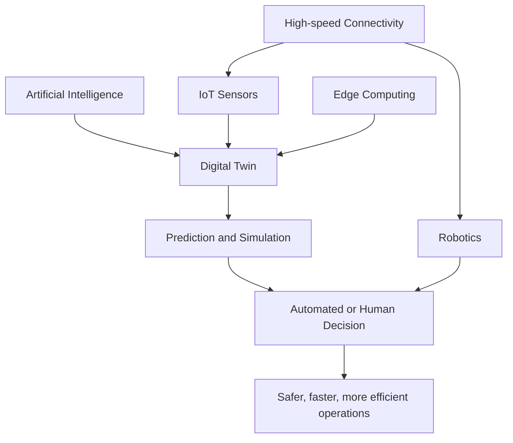
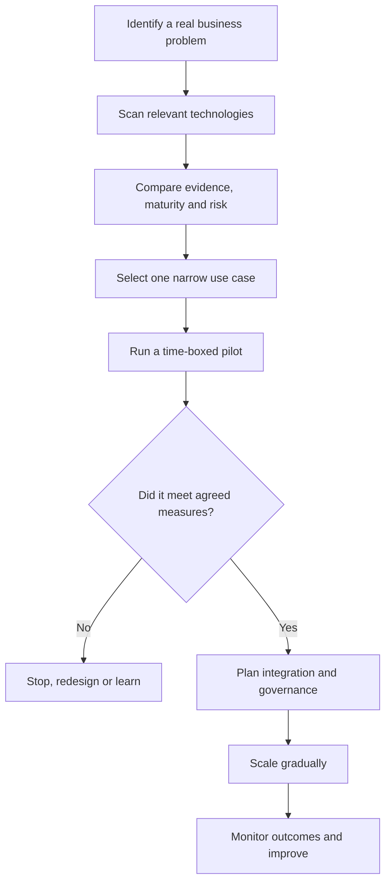

# Understanding Emerging Technology

## A practical guide to recognizing, evaluating, and applying the technologies shaping tomorrow

> **Article overview:** Emerging technology is not simply technology
> that is new. It is technology, or a combination of technologies, whose
> capabilities, adoption, economics, or social consequences are changing
> quickly enough to create new possibilities---and new uncertainties.
> This guide explains how to understand that change, assess what is
> real, and turn technological awareness into sound decisions.

------------------------------------------------------------------------

## 1. Introduction: Why emerging technology matters

Technology has always changed how people live and work. The printing
press expanded access to knowledge; electricity transformed industry and
cities; computers automated calculation and information processing; the
internet connected people and markets at global scale. Each wave began
as a collection of unfamiliar inventions and gradually became part of
everyday life.

Today, change is arriving through several overlapping waves: artificial
intelligence, robotics, biotechnology, quantum computing, advanced
materials, immersive interfaces, clean energy, space systems, and
increasingly capable networks. These are not isolated developments. They
reinforce one another. AI can accelerate drug discovery; robotics can
make factories more adaptive; new batteries can make electric transport
more practical; satellite networks can connect remote sensors; and
advanced materials can improve energy storage.

Understanding emerging technology is therefore a strategic skill. It
helps a business decide where to invest, a professional decide what to
learn, a government anticipate risks, and an individual distinguish
meaningful progress from publicity.

The objective is not to predict every breakthrough. It is to develop a
disciplined way to ask: **What has changed? What is now possible? What
evidence supports the claim? Who benefits? What could go wrong? And what
should we do next?**

## 2. What exactly is emerging technology?

An emerging technology is a technology that is still developing, gaining
adoption, or changing the way an existing problem can be solved. It may
be entirely new, but it can also be an established technology reaching a
tipping point because its cost has fallen, its performance has improved,
or another technology has made it more useful.

For example, machine learning has existed for decades. Its recent
emergence as a mainstream business capability was driven by a
combination of larger datasets, specialised processors, improved model
architectures, cloud infrastructure, and accessible interfaces. The
important change was not one invention; it was the arrival of a
practical system.

A technology can be considered emerging when one or more of these
conditions apply:

-   **Rapid capability improvement:** It can perform tasks that were
    previously impractical or impossible.
-   **Falling cost:** A capability becomes affordable to a much larger
    group of users.
-   **New use cases:** It enables products, services, or business models
    that did not previously make economic sense.
-   **Convergence:** It becomes powerful when combined with other
    technologies.
-   **Changing adoption:** It moves from laboratories and specialist
    teams into mainstream organisations.
-   **Unsettled consequences:** Its standards, regulation, safety
    practices, or social impact are still evolving.

### Emerging does not mean automatically important

A spectacular demonstration is not the same as a useful technology. A
prototype may work under controlled conditions but fail in the real
world because it is too expensive, unreliable, difficult to maintain,
unsafe, or hard to integrate.

It is useful to separate three stages:

1.  **Scientific or technical possibility:** Can it work at all?
2.  **Engineering and economic viability:** Can it work reliably, at
    scale, and at a sustainable cost?
3.  **Meaningful adoption:** Do people and organisations actually use
    it, and does it create measurable value?

A technology may remain at the first stage for years. Others move
through all three stages quickly.

## 3. The major technology domains to understand

The following domains are not a ranking. Their maturity varies
significantly, and progress in one can accelerate another.

### 3.1 Artificial intelligence and intelligent agents

Artificial intelligence (AI) refers to computer systems that perform
tasks associated with human intelligence, such as recognising patterns,
understanding language, generating content, planning, and making
predictions.

Modern AI includes several related approaches:

-   **Machine learning:** Systems learn patterns from data rather than
    relying only on hand-written rules.
-   **Deep learning:** Multi-layer neural networks learn complex
    representations, especially from images, audio, video, and language.
-   **Generative AI:** Models create new text, code, images, audio,
    video, or structured outputs.
-   **Multimodal AI:** Models work across combinations of text, images,
    audio, and video.
-   **AI agents:** Systems use models together with tools, memory, and
    workflows to pursue goals through multiple steps.

**Example --- customer support:** A traditional chatbot might match a
question to a predefined answer. A generative AI assistant can interpret
a customer's issue, search approved documentation, summarise relevant
policy, draft a response, and escalate the case when confidence is low.
An agentic workflow might also update a ticket or initiate a permitted
refund after checking the required conditions.

The important distinction is between *generating a plausible answer* and
*reliably completing a task*. Production systems need access controls,
audit trails, evaluation, human review for high-impact decisions, and
clear limits on what an agent may do.

AI also has limitations: it can produce incorrect information, inherit
bias from data, expose sensitive information if poorly designed, and
behave unpredictably when instructions or context are ambiguous. Good
implementation treats AI as a component in a controlled system---not as
an infallible authority.

### 3.2 Robotics and autonomous systems

Robotics combines mechanical engineering, electronics, sensors, control
systems, and software. Newer systems increasingly use AI to interpret
their surroundings and adapt to changing conditions.

Examples include:

-   Collaborative robots that work beside people on assembly lines.
-   Autonomous mobile robots that move goods through warehouses.
-   Surgical robots that help clinicians perform precise procedures.
-   Agricultural robots that inspect crops, remove weeds, or support
    harvesting.
-   Drones used for inspection, mapping, emergency response, and
    infrastructure monitoring.

**Example --- a modern warehouse:** A warehouse may combine barcode
systems, computer vision, route-planning software, autonomous mobile
robots, and human workers. The robots move shelves or containers;
software assigns tasks; sensors help prevent collisions; and people
handle exceptions and decisions requiring judgement.

The difficult part is often not making a robot move. It is making it
operate safely amid unpredictable people, objects, weather, equipment
failures, and changing tasks. Reliability, maintenance, battery life,
safety certification, and total cost of ownership determine whether a
deployment succeeds.

### 3.3 Quantum computing

Classical computers process information using bits, typically
represented as 0 or 1. Quantum computers use quantum bits, or *qubits*,
which can exploit properties such as superposition and entanglement.

Quantum computing is not simply a faster replacement for ordinary
computers. It is a different computational approach that may offer
advantages for selected problems, such as certain simulations of quantum
systems, specialised optimisation tasks, and some cryptographic or
mathematical problems.

Potential applications include:

-   Simulating molecules and materials.
-   Supporting research into catalysts and battery chemistry.
-   Exploring specialised optimisation problems.
-   Advancing scientific understanding of complex quantum systems.

**Example --- materials research:** Accurately modelling the quantum
behaviour of molecules can be difficult for classical computers. A
sufficiently capable fault-tolerant quantum computer could help
researchers simulate some molecular systems more naturally, potentially
accelerating the search for useful materials or chemical processes.

There are major obstacles. Qubits are fragile, errors accumulate, and
useful large-scale systems require error correction and substantial
engineering. Many claims about near-term commercial advantage should
therefore be treated cautiously. Quantum computers are specialised
research platforms, not general-purpose replacements for laptops or
cloud servers.

Quantum progress also creates a security planning issue. Organisations
should understand *post-quantum cryptography*: cryptographic algorithms
designed to resist attacks from future quantum computers. Migration
takes time because encryption is embedded in applications, devices,
certificates, and long-lived data.

### 3.4 Biotechnology and synthetic biology

Biotechnology uses living systems, cells, or biological processes to
develop products and solve problems. Synthetic biology applies
engineering principles to design or modify biological systems.

Important developments include:

-   Gene editing, including CRISPR-based techniques.
-   mRNA and other advanced vaccine platforms.
-   Precision medicine based on an individual's biological
    characteristics.
-   Engineered microbes for producing chemicals, materials, or fuels.
-   AI-assisted analysis of proteins, genes, and biological data.

**Example --- precision medicine:** Instead of assuming that every
patient with the same diagnosis will respond identically, clinicians may
combine genetic information, medical history, biomarkers, and clinical
evidence to select or adjust a treatment. This can improve treatment
decisions in certain conditions, although access, validation, privacy,
and clinical oversight remain essential.

Biotechnology can have profound benefits, but it also raises questions
about biosafety, biosecurity, consent, genetic privacy, affordability,
and equitable access. A laboratory result is not automatically a safe or
approved medical treatment.

### 3.5 Internet of Things, edge computing, and digital twins

The Internet of Things (IoT) connects physical objects---machines,
vehicles, meters, cameras, appliances, and environmental sensors---to
networks and software.

An IoT solution commonly includes:

1.  Sensors that collect information.
2.  Connectivity that transports information.
3.  Edge or cloud computing that processes it.
4.  Applications that present insights or trigger actions.

**Example --- predictive maintenance:** Sensors on an industrial motor
measure vibration, temperature, and power consumption. Software detects
patterns that may indicate bearing wear. Maintenance teams can inspect
the motor before a failure causes an unplanned shutdown.

**Edge computing** processes data close to where it is produced, rather
than sending everything to a distant cloud. This can reduce latency,
bandwidth use, and dependence on continuous connectivity. A factory
safety system, for example, may need to respond locally in milliseconds.

A **digital twin** is a digital representation of a physical asset,
process, or system that is updated using operational data. A digital
twin of a building might combine occupancy, temperature, energy use,
equipment status, and floor plans to help operators test ways to reduce
energy consumption.

A dashboard is not automatically a digital twin. A useful twin
represents relevant behaviour, stays connected to real-world data, and
supports analysis or decisions.

### 3.6 Extended reality: AR, VR, and spatial computing

Extended reality (XR) includes:

-   **Virtual reality (VR):** Immerses a user in a computer-generated
    environment.
-   **Augmented reality (AR):** Adds digital information to a view of
    the physical world.
-   **Mixed reality (MR):** Allows digital objects and physical
    surroundings to interact more directly.

**Example --- equipment maintenance:** A technician wearing AR glasses
could see instructions, component labels, wiring diagrams, or remote
expert annotations aligned with the equipment being repaired. This may
reduce the need to consult a separate manual, although the interface
must remain safe and usable in a real working environment.

XR is useful in training, simulation, design reviews, remote assistance,
education, and selected entertainment applications. Its wider adoption
depends on comfort, battery life, display quality, price, privacy, and
genuinely useful applications.

### 3.7 Clean energy, batteries, and electrification

The energy transition is being shaped by solar and wind generation,
battery storage, electric vehicles, heat pumps, smart grids, advanced
nuclear technologies, and new approaches to hydrogen and industrial
decarbonisation.

The challenge is not only generating clean electricity. Energy systems
must also store it, move it, balance supply and demand, and remain
reliable.

**Example --- a smart home:** Rooftop solar panels generate electricity
during daylight. A home battery stores some of the surplus. Smart
controls schedule selected appliances when electricity is abundant or
cheaper. An electric vehicle can add a flexible load---and, where
supported, potentially return power to the home or grid.

Battery chemistry, charging infrastructure, grid capacity, mineral
supply chains, recycling, and lifecycle emissions all matter. No single
technology solves every energy problem; the best mix depends on
geography, demand, economics, and the reliability requirements of the
grid.

### 3.8 Advanced materials and manufacturing

Advanced materials are engineered to provide particular properties:
lower weight, greater strength, improved conductivity, heat resistance,
flexibility, or specialised optical and chemical behaviour.

Examples include:

-   Graphene and other two-dimensional materials.
-   Advanced composites used in aircraft and vehicles.
-   Solid-state battery materials.
-   High-performance ceramics and coatings.
-   Additive manufacturing, commonly called 3D printing.

**Example --- additive manufacturing:** A conventional process may
machine a component from a larger block of metal, removing material that
becomes waste. 3D printing builds a component layer by layer. This can
enable complex geometries, rapid prototyping, and customised low-volume
parts. It is not always cheaper or faster for mass production, and
material quality, inspection, and certification are critical.

### 3.9 Next-generation connectivity and space technology

Connectivity technologies such as 5G and evolving 6G research aim to
improve capacity, latency, reliability, and support for large numbers of
connected devices. Satellite constellations can extend broadband and
sensing capabilities to areas where terrestrial networks are difficult
to deploy.

Space technology is also becoming more diverse: Earth observation,
navigation, communications, launch services, and scientific missions
provide data and infrastructure used by agriculture, logistics, disaster
response, climate research, and defence.

**Example --- agriculture:** Satellite imagery can help identify crop
stress across large areas. Combined with local weather data and field
sensors, it can guide targeted inspection and irrigation. The value
comes from combining reliable data with decisions---not from the
satellite image alone.

------------------------------------------------------------------------

## 4. Technology convergence: where the biggest opportunities often appear

Some of the most important breakthroughs occur when technologies
combine. A single technology may improve one task; a connected system
can change an entire process.

Consider a smart factory:

-   IoT sensors collect machine data.
-   Edge computers detect urgent anomalies locally.
-   AI models predict equipment failures.
-   A digital twin simulates production changes.
-   Robots move materials and perform repetitive tasks.
-   Human operators supervise exceptions and safety.

The value is created by the integrated workflow. Buying an AI model, a
robot, or a sensor in isolation may not produce the same result.

Other examples of convergence include AI plus biotechnology for drug
discovery, AI plus satellite imagery for environmental monitoring, and
advanced batteries plus smart grids for flexible electricity systems.

## 5. How to evaluate an emerging technology

When a new technology attracts attention, use a consistent evaluation
framework rather than relying on headlines or vendor presentations.

### 5.1 Start with the problem

Ask what specific problem the technology solves. Is the problem
important, frequent, expensive, dangerous, or frustrating? A technically
impressive solution has little value if the underlying problem is minor.

### 5.2 Examine the evidence

Look for independent evaluations, peer-reviewed research where
appropriate, production deployments, benchmark methodology, and customer
outcomes. Distinguish a controlled demonstration from sustained
operation in real conditions.

Ask:

- What was measured?
- What was the baseline?
- Were results independently verified?
- Does the result apply to the environment in which it will be used?
- What limitations or failure cases were reported?

### 5.3 Assess maturity

A useful shorthand is Technology Readiness Level (TRL), a scale commonly
used to describe progression from basic principles to proven operation
in relevant or operational environments. TRL is not a guarantee of
commercial success, but it helps separate laboratory research from
deployable systems.

  -----------------------------------------------------------------------
  Stage                   Typical evidence        Appropriate response
  ----------------------- ----------------------- -----------------------
  Early research          Scientific principles   Monitor and learn
                          and laboratory          
                          experiments             

  Prototype               A working demonstration Run a limited
                          in controlled           experiment
                          conditions              

  Pilot                   Tested in a relevant    Measure reliability and
                          environment             economics

  Early adoption          Real customers and      Evaluate carefully for
                          repeatable deployments  specific use cases

  Mature adoption         Established suppliers,  Consider broader
                          standards, support, and implementation
                          operating practices     
  -----------------------------------------------------------------------

### 5.4 Understand the economics

Calculate total cost of ownership, not just purchase price. Include
infrastructure, integration, training, energy, maintenance,
cybersecurity, licensing, compliance, upgrades, and the cost of failure.

A robot that reduces labour time may still be uneconomic if it requires
expensive facility changes. An AI system may appear inexpensive per
request but become costly when data preparation, human review, and
integration are included.

### 5.5 Evaluate risk and responsibility

Assess safety, privacy, security, bias, intellectual property,
environmental impact, regulatory obligations, and the possibility of
vendor lock-in. Identify who is accountable when the system makes a
mistake.

For high-impact decisions---such as healthcare, credit, employment,
critical infrastructure, or public safety---technical performance alone
is not enough. Governance and human accountability are essential.

### 5.6 Ask whether it can scale

A successful pilot may depend on exceptional engineers, clean data,
manual work, or favourable conditions. Scaling requires repeatable
processes, support, supply chains, skilled people, interoperability, and
reliable operations.

## 6. A practical framework for adopting emerging technology

Organisations do not need to adopt every new technology. They need a
process that helps them experiment without exposing the business to
unnecessary risk.

A sensible adoption process has seven steps:

1.  **Define the outcome.** Specify what should improve: cycle time,
    quality, cost, customer satisfaction, safety, or revenue.
2.  **Choose a bounded use case.** Start with a task where the
    consequences of failure are manageable.
3.  **Establish a baseline.** Record how the process performs today.
4.  **Run a controlled pilot.** Define duration, participants, data
    access, success measures, and stop conditions.
5.  **Evaluate the whole workflow.** Include human effort, exceptions,
    integration, and ongoing support.
6.  **Put controls in place.** Assign ownership, access rights, audit
    requirements, security measures, and escalation paths.
7.  **Scale only when justified.** Expand in stages and keep measuring
    performance.

**Example --- introducing AI into software development:** A team could
begin by using an AI assistant to explain unfamiliar code, generate test
ideas, or draft documentation. It should measure review time, defect
rates, and developer experience against a baseline. Generated code must
still pass tests, security checks, and human review. Only after evidence
of value should the team expand to more sensitive tasks.

## 7. The human dimension: skills, jobs, and organisational change

Emerging technology changes tasks before it necessarily eliminates
entire occupations. Automation may take over repetitive activities while
increasing demand for judgement, communication, domain expertise, system
design, oversight, and problem-solving.

The most valuable professionals will often be those who combine
technical fluency with deep knowledge of a particular field. A
manufacturing expert who understands data and automation, for example,
may be better positioned to improve a factory than someone who knows
only the technology or only the production process.

Important capabilities include:

-   **Technology literacy:** Understanding what systems can and cannot
    do.
-   **Critical thinking:** Checking evidence, assumptions, and outputs.
-   **Data literacy:** Interpreting data quality, uncertainty, and
    measurement.
-   **Systems thinking:** Seeing dependencies across people, software,
    infrastructure, and processes.
-   **Adaptability:** Learning continuously as tools and practices
    change.
-   **Ethical judgement:** Recognising who may be harmed or excluded by
    a deployment.

The goal is not for everyone to become a programmer or AI researcher. It
is for people to understand enough to ask good questions, make informed
decisions, and work effectively with technical specialists.

## 8. Common mistakes when interpreting technology trends

1.  **Confusing a demonstration with a product.** A compelling prototype
    may not be reliable, affordable, or supportable.
2.  **Believing every prediction.** Forecasts are scenarios, not facts.
    Check assumptions and time horizons.
3.  **Focusing on features instead of outcomes.** More capability does
    not automatically mean more value.
4.  **Ignoring integration.** Legacy systems, poor data, and
    organisational processes can determine success or failure.
5.  **Underestimating security and privacy.** New connections and data
    flows create new attack surfaces.
6.  **Assuming adoption is inevitable.** Regulation, economics, culture,
    infrastructure, and public trust can slow or redirect a technology.
7.  **Ignoring opportunity cost.** Time and money spent on a fashionable
    project cannot be spent elsewhere.
8.  **Treating AI output as verified truth.** Generated content must be
    checked, especially when decisions have material consequences.

A healthy attitude combines curiosity with scepticism: be open to new
possibilities, but demand evidence before making consequential
commitments.

## 9. How individuals can stay informed without becoming overwhelmed

The volume of technology news can make it difficult to distinguish
durable developments from daily noise. A practical learning routine is
more effective than trying to follow everything.

-   Choose two or three domains relevant to your work or interests.
-   Follow primary research institutions, standards bodies, technical
    documentation, and credible industry analysis.
-   Read beyond headlines: understand the underlying mechanism and
    limitations.
-   Try small, safe experiments instead of relying entirely on
    commentary.
-   Keep a simple trend journal: what changed, what evidence appeared,
    what remains uncertain, and what might become useful.
-   Revisit older predictions. This builds an understanding of how often
    forecasts are right or wrong.

A useful monthly review can ask: Which capability improved? Did costs
fall? Did a new standard or regulation appear? Are real customers
adopting it? Has a practical use case become economically viable?

## 10. Looking ahead: from individual inventions to intelligent systems

The next phase of technological change is likely to be defined less by
isolated gadgets and more by systems that combine computation, physical
infrastructure, biological processes, and human decisions.

AI may become a more common interface to software and services. Robots
may take on a wider range of tasks in structured environments.
Biotechnology may make some treatments more precise. Energy storage and
grid software may help integrate variable renewable power. Sensors and
digital twins may make infrastructure more observable and easier to
optimise.

However, progress will not be uniform. Some technologies will mature
quickly; others will encounter scientific, economic, regulatory, or
social barriers. There will be failures, exaggerated claims, unexpected
consequences, and genuine breakthroughs.

The organisations and individuals best prepared for this future will not
necessarily be those that adopt every new tool first. They will be those
that learn continuously, test claims carefully, understand systems,
protect people, and apply technology to meaningful problems.

## 11. Conclusion: understand the change, not just the technology

Understanding emerging technology is ultimately about understanding
change. It requires enough technical knowledge to see what is possible,
enough business and social awareness to judge what is useful, and enough
critical thinking to recognise what is uncertain.

A disciplined approach can be summarised in five questions:

1.  **What is genuinely new?**
2.  **What problem does it solve?**
3.  **What evidence shows that it works?**
4.  **What risks, costs, and dependencies come with it?**
5.  **What small experiment would help us learn?**

Technology should not be adopted because it is fashionable, nor rejected
because it is unfamiliar. It should be understood, tested, governed, and
applied where it creates real value. That is the difference between
merely following technology trends and being prepared to shape the
future.

------------------------------------------------------------------------

## Further reading and research starting points

The following organisations publish useful technical, scientific, and
policy material. Consult their latest publications for developments
beyond the examples in this article.

-   [Stanford Institute for Human-Centered AI
    (HAI)](https://hai.stanford.edu/) --- AI research, policy, and the
    annual AI Index.
-   [National Institute of Standards and Technology
    (NIST)](https://www.nist.gov/) --- cybersecurity, standards,
    measurement, and post-quantum cryptography.
-   [World Economic Forum](https://www.weforum.org/) --- technology
    convergence, industry transformation, and emerging technology
    analysis.
-   [International Energy Agency (IEA)](https://www.iea.org/) --- energy
    technologies, electrification, batteries, and energy-system
    transitions.
-   [World Health Organization (WHO)](https://www.who.int/) --- health
    technology, digital health, and guidance on responsible
    implementation.
-   [MIT Technology Review](https://www.technologyreview.com/) ---
    reporting and analysis on technology research and commercialisation.

*Editorial note: Technology maturity and regulatory status vary by
country and application. Examples in this article are intended for
general education, not as investment, medical, legal, or engineering
advice.*
